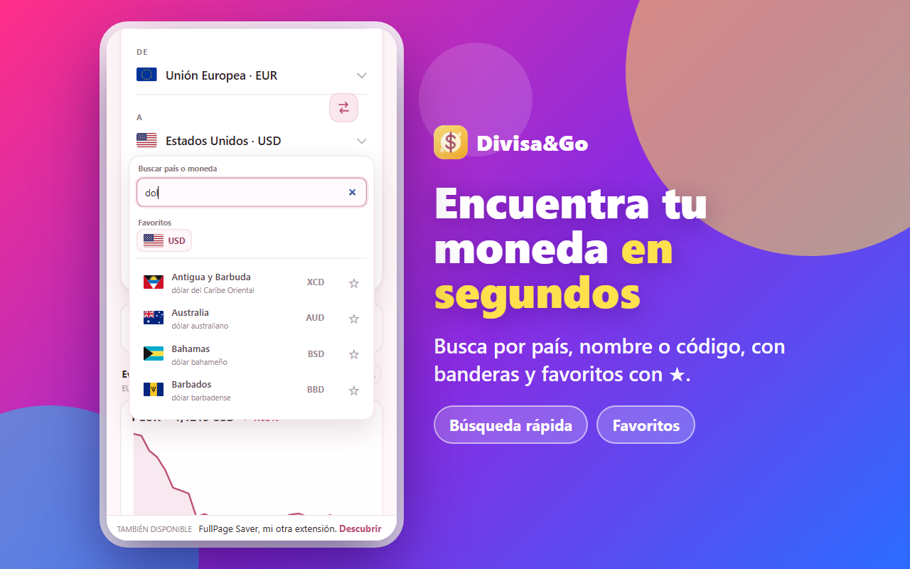

# Divisa&Go

**Tu dinero, sin fronteras.** Extensión de Chrome para convertir divisas, calcular, ver su evolución, comparar fuentes y consultar precios cripto.

    

**[Capturas](#capturas)** · **[Funciones](#funciones)** · **[Instalar](#instalación-y-actualización)** · **[Privacidad](#privacidad)** · **[Soporte](#soporte)** · [🌐 Web](https://divisaandgo.netlify.app/) · [🖥️ Versión para Windows](https://github.com/dannymedinacoronel/DivisaGo-support)

---

Divisa&Go es una extensión de Chrome para convertir divisas desde un popup compacto bajo el icono de la barra superior. Permite buscar monedas por país, nombre o código, consultar tasas de referencia, comparar cuatro fuentes pequeñas y copiar el resultado con un clic.

## Capturas

| | |
|---|---|
|  |  |
|  |  |
|  |  |

## Funciones

- Catálogo dinámico de monedas con cotización disponible, banderas y nombres localizados. Las monedas se distinguen por país y código ISO; por ejemplo, USD es el dólar estadounidense y CAD el canadiense.
- Búsqueda sin distinguir mayúsculas ni tildes. Escribe un país, un nombre de moneda o un código como `CAD`.
- Monedas favoritas: marca la estrella junto a una moneda en el selector y aparecerá en accesos rápidos en la parte superior de ambos selectores. La lista se guarda localmente en Chrome.
- Conversión cruzada entre cualquier par cubierto por la fuente principal. El cálculo se hace en el dispositivo y el importe se guarda temporalmente en la sesión del navegador para recuperarlo si se cierra el popup.
- Conversión de una divisa a sí misma disponible incluso sin conexión, porque no requiere consultar tipos de cambio.
- Cuatro tarjetas compactas para el par seleccionado: BCE, Wise, Xe y TradingView. Cada referencia es independiente y puede no estar disponible para ciertos pares.
- Selector de idioma al abrir el popup: español, inglés, portugués, francés, alemán e italiano. La elección se guarda en el almacenamiento local de Chrome y se restaura automáticamente en siguientes aperturas.
- Si el popup se cierra, el importe, las monedas elegidas, el tema y el idioma de la sesión se restauran al volver a abrirlo. Estos datos temporales se borran al cerrar Chrome.
- Actualización manual de las referencias y actualización periódica de Wise, Xe y TradingView.
- Copia del resultado al pulsar el recuadro de conversión.
- Temas Rosa, Día y Noche. La selección no se guarda y se restablece al recargar el popup.
- Popup anclado al icono de la extensión en la barra superior; no abre una pestaña ni una ventana aparte. Se cierra al hacer clic fuera de él.

## Instalación y actualización

1. Ve a **[Releases](../../releases/latest)** y descarga `divisa-and-go-1.5.0.zip`.
2. Descomprime el ZIP en una carpeta que no vayas a borrar (Chrome la lee desde ahí).
3. Abre `chrome://extensions` y activa **Modo de desarrollador**.
4. Selecciona **Cargar descomprimida** y elige la carpeta descomprimida.
5. Pulsa el icono de Divisa&Go para abrir el popup debajo del icono.

Para actualizar, descarga el ZIP del último Release, sustituye la carpeta y pulsa el botón de recarga de Divisa&Go en `chrome://extensions`.

Al abrir el popup por primera vez, elige uno de los seis idiomas disponibles y pulsa **Continuar**. Divisa&Go recuerda el idioma en el almacenamiento local de Chrome; puedes cambiarlo desde el selector de la cabecera.

## Tipos de cambio y referencias

### Conversión principal: Frankfurter

La conversión principal obtiene los tipos diarios de la API abierta de [Frankfurter](https://frankfurter.dev/), que recopila referencias de bancos centrales y otras fuentes oficiales. Divisa&Go solicita tasas con base en el euro dentro de un intervalo reciente que termina en la fecha UTC actual; así puede elegir la última observación válida aunque la API también publique fechas futuras. El par elegido se calcula localmente. La fecha de referencia se muestra junto al cambio. Si las dos monedas tienen fechas de observación distintas, se muestran las fechas correspondientes.

La consulta de tipos se cancela si no responde en 15 segundos, para que el panel no se quede cargando indefinidamente; puedes volver a intentarlo con el botón de actualización.

Si Frankfurter no responde o no ofrece una tasa para el par seleccionado, Divisa&Go usa la primera referencia reciente disponible en este orden: BCE, Wise, Xe y TradingView. La fuente utilizada aparece en pequeño junto al resultado y la tasa de referencia debajo; las tarjetas de las demás fuentes siguen mostrando sus propias referencias. Si ninguna alternativa está disponible, pero Frankfurter ya había devuelto tasas durante esta sesión, se conserva esa referencia en memoria y se identifica como última tasa recibida. Wise, Xe y TradingView son referencias indicativas y pueden no estar disponibles temporalmente.

El catálogo se adapta a las monedas disponibles en las respuestas del servicio y a los países asociados a cada código. La cobertura puede cambiar y no incluye necesariamente todas las monedas que existen. Si no hay una tasa reciente para el par ni una referencia alternativa disponible, el conversor lo marca como no disponible en lugar de inventar el dato. La API está disponible en [api.frankfurter.dev](https://api.frankfurter.dev/v2/rates?base=EUR).

Frankfurter es un agregador abierto, no un banco central. Sus tasas son referencias diarias y no cotizaciones en tiempo real, precios de compra garantizados ni necesariamente el importe final de una transferencia. La fiabilidad y fecha dependen de las instituciones proveedoras. Consulta la lista de [fuentes y proveedores de Frankfurter](https://frankfurter.dev/providers/).

### Tarjetas de referencia

Las cuatro tarjetas consultan el mismo par de monedas y muestran el resultado para una unidad. Si falta el tipo principal, también pueden servir como respaldo siguiendo el orden BCE, Wise, Xe y TradingView; la aplicación identifica junto a la conversión cuál está usando:

| Fuente | Cómo se obtiene | Fecha y disponibilidad |
| --- | --- | --- |
| Banco Central Europeo (BCE) | API pública oficial del [BCE](https://data.ecb.europa.eu/), tasas de referencia diarias frente al euro; Divisa&Go calcula el cruce. | Muestra la fecha oficial. Solo funciona cuando el BCE publica las dos monedas del par; su cobertura es menor que la del conversor. |
| Wise | Lectura de la página pública de conversión de [Wise](https://wise.com/). | Se muestra la hora de consulta de la página; no garantiza que la tasa se actualizara en ese instante. |
| Xe | Lectura de la página pública del conversor de [Xe](https://www.xe.com/). | Se muestra la hora de consulta y, cuando aparece, la hora de referencia publicada por Xe. |
| TradingView | Lectura de la página pública del par de [TradingView](https://www.tradingview.com/). | Se muestra la hora de consulta. La disponibilidad o el retraso pueden depender del instrumento y de su proveedor de datos. |

Las tarjetas de Wise, Xe y TradingView se consultan al cambiar el par, cada cinco minutos y al pulsar el botón de actualización. Sus páginas pueden cambiar, limitar solicitudes o no publicar la tasa esperada; por eso una tarjeta puede quedar temporalmente sin datos. Las lecturas de estas páginas públicas no son integraciones oficiales y sus tasas son indicativas: no garantizan el precio ni las comisiones de una operación. El BCE tampoco es una cotización en tiempo real. Comprueba siempre el importe final con el banco o proveedor donde realices el cambio.

El BCE suele actualizar sus tipos de referencia alrededor de las **16:00 CET cada día hábil**, excepto los días de cierre de TARGET. Son tipos diarios de referencia, no precios en tiempo real.

## Privacidad

**Resumen:** sin cuentas, sin analítica y sin seguimiento propio.

- Solo se guardan **en tu navegador** el idioma elegido y las monedas favoritas. El importe, el par de monedas, el tema y el idioma aún no confirmado se guardan temporalmente en el almacenamiento de sesión y se borran al cerrar Chrome.
- Para obtener tipos se consulta a Frankfurter y al BCE, y para las demás referencias a Wise, Xe y TradingView (y a CoinGecko, Binance, Coinbase y Kraken en la sección Cripto). Solo se envían los **códigos del par de monedas; nunca el importe**. Como en cualquier conexión web, esos proveedores pueden recibir datos técnicos de conexión (como tu IP) y los tratan según sus propias políticas.
- El resultado solo se copia al portapapeles cuando pulsas el recuadro.
- Todo se elimina al borrar los datos de la extensión o desinstalarla.

Política completa: **[PRIVACY.md](PRIVACY.md)** · también en la [web](https://divisaandgo.netlify.app/soporte.html#privacidad).

## Interfaz e identidad

El icono de la barra sigue el diseño amarillo de Divisa&Go. Las banderas se incluyen como archivos SVG locales de [Twemoji](https://github.com/jdecked/twemoji), bajo licencia [CC BY 4.0](https://creativecommons.org/licenses/by/4.0/), para que se vean aunque el sistema no tenga fuentes de emoji con banderas.

## Soporte

¿Algo no funciona o tienes una duda? Hay tres vías, de la más rápida a la más completa:

1. **Preguntas frecuentes** (justo debajo): resuelven la mayoría de los casos.
2. **Una incidencia en GitHub**: [abre una aquí](https://github.com/dannymedinacoronel/DivisaGo-Extension/issues/new?template=problema.md). Es la mejor opción para fallos, porque queda registrado y otros usuarios pueden verlo.
3. **Correo**: [empresademkor@gmail.com](mailto:empresademkor@gmail.com) para consultas privadas, privacidad o sugerencias.
4. **Web de soporte**: [divisaandgo.netlify.app/soporte](https://divisaandgo.netlify.app/soporte.html) (preguntas frecuentes y contacto).

**Para poder ayudarte rápido, incluye:** la versión de Divisa&Go (en `chrome://extensions`), tu versión de Chrome (`chrome://settings/help`), tu sistema operativo, qué esperabas que pasara y qué pasó, y los pasos para repetirlo. No envíes contraseñas ni datos personales.

### Preguntas frecuentes

<b>Una tarjeta (Wise, Xe, TradingView o BCE) sale sin datos</b>

Es normal de forma temporal. Wise, Xe y TradingView se leen de sus páginas públicas, que pueden cambiar, limitar solicitudes o no publicar el par; el BCE solo cubre las monedas que publica. Pulsa el botón de actualizar. La conversión principal (Frankfurter) y las demás tarjetas siguen funcionando.

<b>¿Por qué el resultado no coincide con mi banco o con Xe?</b>

Las tasas son **de referencia e indicativas**, no el precio de una operación: no incluyen comisiones ni márgenes y el BCE solo publica tipos diarios (alrededor de las 16:00 CET en días hábiles). Comprueba siempre el importe final con tu banco o proveedor.

<b>No carga ninguna tasa</b>

La consulta se cancela a los 15 segundos si no hay respuesta. Comprueba tu conexión y pulsa actualizar. Si Frankfurter no responde, se usa la primera referencia disponible (BCE, Wise, Xe, TradingView); si ninguna está disponible se conserva la última tasa recibida en esta sesión.

<b>¿Funciona sin conexión?</b>

Solo convertir una divisa a sí misma. Para el resto hace falta conexión para consultar los tipos.

<b>Mis favoritas o el idioma han desaparecido</b>

Se guardan en el almacenamiento local de la extensión: se pierden si desinstalas Divisa&Go o borras sus datos. El importe y el tema son temporales y se restablecen al cerrar Chrome.

<b>¿Qué fuente usa el cálculo principal?</b>

[Frankfurter](https://frankfurter.dev/) (tipos diarios de bancos centrales). El par elegido se calcula en tu equipo; se muestra la fecha de referencia.

<b>Cómo actualizar a una versión nueva</b>

Descarga el ZIP del [último Release](https://github.com/dannymedinacoronel/DivisaGo-Extension/releases/latest), sustituye la carpeta anterior y pulsa el botón de recargar de Divisa&Go en `chrome://extensions`.

<b>¿Hay versión para Windows?</b>

Sí: una aplicación de escritorio con la chincheta para mantenerla siempre visible. Descárgala en [DivisaGo-support](https://github.com/dannymedinacoronel/DivisaGo-support).

## Créditos

Desarrollado por **Demkor Consultants**.  
Desarrollador principal: **Danny Medina Coronel**.

© 2026 Demkor Consultants. Todos los derechos reservados.
